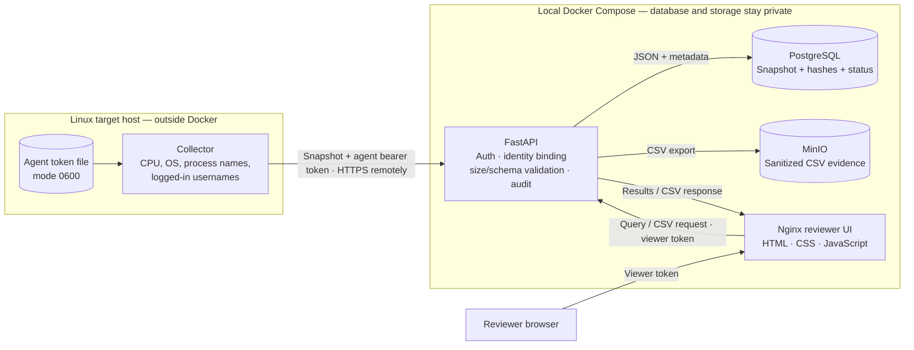

# Secure Server Compliance Evidence Collector

A local demonstration of Linux inventory collection, authenticated submission, evidence storage, and authorized review. The project is designed as a short technical challenge: it demonstrates selected engineering controls and their trade-offs. It is **not** a production-ready service, a control assessment, or a compliance certification.

## Exercise at a glance

The Linux collector runs separately from Docker. It submits a minimized inventory snapshot to the API with an agent token. The API validates the token, server identity, payload size, and schema; it stores the record and integrity metadata in PostgreSQL and exports a sanitized CSV to MinIO. A reviewer uses the web UI and a separate viewer token to query snapshots and download available CSV evidence through the API.



The diagram shows logical data flow: the API mediates access to both storage services, while only the API (`localhost:8000`) and web UI (`localhost:8080`) are published to the host. Local Compose is for demonstration; it does not make the collector tamper-proof against an administrator on its target host.

For the detailed trust boundaries and lifecycle, see [Architecture](docs/architecture.md). For the verified run-through and known limits, see [Iteration 5](docs/phases/README.md) and the [compliance gap register](docs/compliance-gaps.md).

## Iteration history

The implementation is organized as a sequence of iterations. “Implemented” means the code or documentation is present in the repository. Verification status is reported separately for each iteration and covers only the checks explicitly listed; it is not an independent audit or evidence of operation over an audit period.

### Iteration 0 — Challenge analysis and scope

**Objective:** Turn the original brief into a security-aware but achievable two-day exercise.

**Decisions recorded:**

- Keep the solution to a single Linux inventory flow and a locally reproducible demo.
- Treat the agent, ingestion API, reviewer UI, database, and evidence storage as distinct components and trust boundaries.
- Make agent authentication, server identity binding, schema validation, bounded input, authorized review, integrity metadata, and audit events part of the core scope.
- Avoid collecting process arguments or environment variables; collect process names and logged-in user names only, while recognizing these can still be sensitive.
- Use PostgreSQL as the query source and CSV as an export artifact rather than the primary record.
- Do not ingest cardholder data. Describe PCI DSS applicability as dependent on the actual CDE and impact scope.
- State that the demo does not use AI, so ISO/IEC 42001 is discussed as a scope boundary rather than claimed as an implemented control.
- Note that ISO/IEC 27701:2025 is the current published edition as of this project’s preparation; confirm which edition the interview scenario expects.

**Documentation:** [Architecture](docs/architecture.md), [Security](docs/security.md), and [Indicative compliance mapping](docs/compliance-mapping.md).

### Iteration 1 — Repository structure and development plan

**Objective:** Establish a simple layout and make the work reviewable phase by phase.

**Implemented:**

- `agent/` for the standalone Linux client.
- `api/` for the Python API and its container image.
- `web/` for a separate reviewer UI container.
- `deploy/` for Docker Compose and database initialization.
- `docs/` for architecture, API, security, compliance mapping, and development phases.
- `.env.example` for local configuration without real credentials; `.gitignore` excludes `.env` and the example agent token file.

**Documentation:** [Development phases](docs/phases/README.md).

### Iteration 2 — Linux collection and authenticated ingestion

**Objective:** Gather a defined snapshot and accept it only from the agent identity authorized for that server.

**Implemented:**

- Python collector gathers CPU architecture/core counts, process names, logged-in usernames, OS name/version, server ID, collection timestamp, execution UUID, and agent version.
- Collection avoids process arguments and environment variables. Lists are bounded before submission.
- Agent sends JSON to `POST /v1/snapshots` with a bearer token.
- Token is read from a restrictive local file or environment variable; the collector checks that a token file is not readable by group/other users.
- API maps each configured token to one server ID and rejects a payload whose server ID does not match.
- Pydantic rejects missing, extra, or incorrectly typed fields; the API enforces a streaming byte limit even when `Content-Length` is absent.
- The API requires a timezone-aware collection timestamp and normalizes it to UTC before persistence.
- Schema errors return field locations and error types without reflecting submitted values; authentication and ingestion rejection events are logged without credentials or payload contents.
- Token comparison uses constant-time byte comparison, including tokens containing non-ASCII characters.
- Conflicting content reusing a `(server_id, execution_id)` pair is rejected; an identical replay is idempotently accepted so a failed CSV export can be retried.
- API logs minimal structured events without logging authorization headers or snapshot content.

**Primary files:** [Collector](agent/collector.py), [API](api/main.py), [API contract](docs/api.md), [Security notes](docs/security.md).

**Verification status:** Python syntax parsing passed during Iteration 2; runtime authentication, identity-mismatch, schema-rejection, and oversized-body checks were completed during the Iteration 5 acceptance walkthrough below.

### Iteration 3 — Persistence, integrity metadata, and CSV evidence

**Objective:** Preserve queryable records and export evidence while limiting accidental formula execution in spreadsheet software.

**Implemented:**

- PostgreSQL stores the snapshot JSON, identifiers, timestamps, payload digest, CSV digest, object key, and evidence status (`pending`, `available`, `failed`, or `legacy_unverified`).
- An idempotent startup migration adds the evidence metadata columns to an existing database volume without deleting its records.
- The API stores a sanitized CSV in MinIO under a deterministic object key and marks it available only after upload succeeds.
- Exact replay of a pending/failed/legacy snapshot retries the same export; different content reusing an execution ID is rejected. Replaying an already available identical snapshot returns `200` without replacing its evidence.
- CSV fields are quoted and values beginning with spreadsheet formula characters are prefixed to neutralize formula interpretation.
- The API verifies the CSV SHA-256 digest against the stored value before download and withholds pending, failed, or legacy/unverified exports.
- Reviewer endpoints return evidence status with recent metadata and allow authenticated CSV download.

**Primary files:** [Database initialization](deploy/init.sql), [API](api/main.py), [API contract](docs/api.md), [Architecture](docs/architecture.md), [Security notes](docs/security.md).

**Integrity limitation:** The CSV digest detects a mismatch against the value stored in PostgreSQL. It is not a signature or immutable storage, and it cannot protect against an actor who can change both the object and its database digest.

**Verification status:** Manually exercised in local Docker using synthetic records. Ingestion returned `201`; identical replay returned `200`; conflicting content with a reused execution ID returned `409`; valid CSV download returned `200`; a tampered CSV returned `500`; taking MinIO offline made a new ingest return `503` and persist `failed`; replay after MinIO recovery regenerated the CSV and set `available`. A simulated legacy schema migrated the existing record to `legacy_unverified`, and replay regenerated its export. PostgreSQL and MinIO container restarts preserved database rows and CSV objects; the full-stack restart was additionally verified in Iteration 5.

### Iteration 4 — Reviewer UI and local container deployment

**Objective:** Make the complete demo reproducible with Docker while leaving the client outside the service stack.

**Implemented:**

- Compose services: API, static web UI, PostgreSQL, and MinIO.
- Python, PostgreSQL, Nginx, and MinIO runtime images are pinned by digest. The MinIO digest is from the public Chainguard image; Docker Hub and Quay MinIO image pulls were unavailable during verification.
- PostgreSQL and MinIO use named persistent volumes and are not published on host ports.
- API and web ports are bound to localhost for the demo.
- API container runs as a non-root user with a read-only root filesystem, dropped capabilities, `no-new-privileges`, and a bounded `/tmp` tmpfs.
- Nginx runs as non-root on port 8080 with a read-only root filesystem, dropped capabilities, `no-new-privileges`, and `/tmp` tmpfs for its working directories.
- PostgreSQL, API, and web healthchecks gate dependent service startup; services restart unless explicitly stopped.
- Nginx applies a self-hosted Content Security Policy without inline script/style permissions plus `nosniff`, frame-denial, and referrer-policy headers.
- The browser UI queries snapshots and downloads CSV without rendering untrusted data as HTML.
- API retries object-storage initialization during startup to accommodate local container startup timing.

**Primary files:** [Compose configuration](deploy/compose.yaml), [Nginx configuration](deploy/nginx.conf), [API Dockerfile](api/Dockerfile), [Web UI](web/index.html), [Web client](web/app.js), [Web styles](web/styles.css), [.env.example](.env.example).

**Verification status:** Docker Compose rebuilt and started successfully. API, PostgreSQL, and web healthchecks passed; the page, JavaScript, and CSS returned `200`; API health returned `200`; CORS preflight allowed the local UI origin and `Authorization`; response headers included the configured CSP and browser security headers. The complete UI interaction was subsequently verified in Chrome during Iteration 5.

### Iteration 5 — Run-through and verification

**Status:** Complete for the documented local challenge acceptance paths. Rotated demo database, MinIO, agent, and viewer credentials; the updated `.env` is ignored by Git. The standalone collector was exercised against local loopback and its remote HTTP policy was checked. Runtime checks confirmed wrong-token (`401`), server-identity mismatch (`403`), invalid schema (`422`), oversized body (`413`), valid ingest (`201`), identical replay (`200`), conflicting replay (`409`), invalid viewer token (`401`), authorized query and CSV download (`200`). A full Compose down/up preserved all four available synthetic snapshots and downloadable CSV objects. Static page/assets, healthchecks, CORS and security headers passed in Iteration 4. Chrome browser walkthrough rendered four snapshots and downloaded/inspected a CSV.

**Acceptance walkthrough:** Completed in Chrome: opened the local reviewer UI, entered the rotated viewer token, queried `demo-linux-01`, confirmed four results rendered, and downloaded/inspected a CSV.

**Agent integrity:** The collector enforces HTTPS for remote API endpoints, uses default TLS certificate verification, and does not follow redirects with the bearer token. These controls protect transport and reduce credential exposure; they do not prevent a privileged actor from modifying the collector or falsifying host data. Signed distribution plus an independently trusted verifier, OS-enforced write/execute controls, and optionally hardware-backed remote attestation are production design options, not implemented here. See [Security notes](docs/security.md#agent-integrity-on-the-destination-host) and [Compliance gaps](docs/compliance-gaps.md).

**Compliance follow-up:** [Compliance gaps](docs/compliance-gaps.md) is a documentation-only cross-framework register covering ISO/IEC 27001, ISO/IEC 27701, ISO/IEC 42001, SOC 2, PCI DSS, and shared implementation/operating evidence. It is a planning aid, not a control assessment or a compliance claim.

The detailed checklist and observed results are in [docs/phases/README.md](docs/phases/README.md). No automated test suite is included.

## Release tags

- [`0.1`](https://github.com/security-inside/sec-compliance-eng-challenge/tree/0.1) — Initial full-stack baseline: Linux collector, authenticated API, PostgreSQL, MinIO CSV evidence storage, reviewer UI, Docker Compose, and initial project documentation. This tag predates Iteration 2 hardening.
- [`0.2`](https://github.com/security-inside/sec-compliance-eng-challenge/tree/0.2) — Iteration 2 ingestion hardening: streamed request-size enforcement, timezone-aware UTC timestamps, value-free schema error responses, rejected-authentication and ingestion audit events, and constant-time byte token comparison. Its original release note recorded the negative paths as pending; those were subsequently verified in Iteration 5.
- [`0.3`](https://github.com/security-inside/sec-compliance-eng-challenge/tree/0.3) — Iteration 3 evidence lifecycle: durable export states, idempotent recovery, legacy-schema migration, CSV digest verification, and a digest-pinned local MinIO image. Local Docker checks covered ingestion/replay/conflict, CSV tampering, storage outage/recovery, schema migration, and PostgreSQL/MinIO container restarts.
- [`0.4`](https://github.com/security-inside/sec-compliance-eng-challenge/tree/0.4) — Iteration 4 deployment hardening: digest-pinned container images, service healthchecks and startup dependencies, non-root/read-only web runtime, capability reduction, no-new-privileges, local-only host ports, and a strict self-hosted CSP. Compose build/startup, healthchecks, static assets, security headers, and CORS preflight passed.
- [`0.5`](https://github.com/security-inside/sec-compliance-eng-challenge/tree/0.5) — Iteration 5 acceptance walkthrough and documentation: local demo credentials rotated; authenticated ingestion and negative paths, authorized review/export, full-stack persistence, standalone collector submission/transport policy, and Chrome reviewer UI query/CSV download verified. Collector requires HTTPS for remote URLs, verifies certificates by default, and refuses redirects; documentation explains that target-host root/admin can still alter the client. Added a documentation-only framework gap register.

## Project structure

```text
agent/       Linux collector, run separately from Docker
api/         FastAPI service, validation, auth, database and object storage
web/         Static reviewer UI served from its own container
deploy/      Docker Compose and PostgreSQL schema initialization
docs/        API, architecture, security, compliance mapping, phase plan, and compliance gap register
```

## Local quick start

1. Copy `.env.example` to `.env`. Replace every placeholder secret with a unique random value. Keep `.env` untracked.
2. Make the agent token in `AGENT_TOKENS` map to the server ID you intend to submit. Use a separate `VIEWER_TOKEN`.
3. Start the local services from the repository root:

   ```sh
   docker compose --env-file .env -f deploy/compose.yaml up --build
   ```

4. On the Linux host to be inventoried, install the collector dependencies, create a token file readable only by your user, and submit a snapshot:

   ```sh
   python -m pip install -r agent/requirements.txt
   chmod 600 agent-token.txt
   python agent/collector.py \
     --api-url http://localhost:8000 \
     --server-id demo-linux-01 \
     --token-file agent-token.txt
   ```

   Put the agent bearer token in `agent-token.txt` before running the command. The example uses localhost and assumes the collector runs on the same machine as the Docker stack. For another host, configure a reachable TLS endpoint; do not send the token over plain HTTP across an untrusted network.

5. Open `http://localhost:8080`, enter the viewer token from `.env`, and query the server ID. The API OpenAPI page is available at `http://localhost:8000/docs`.

To stop the stack, press `Ctrl+C`. To stop and remove the containers while preserving named data volumes, run `docker compose --env-file .env -f deploy/compose.yaml down`. Removing volumes deletes the demo database and stored evidence; do so only when that is intended.

## API summary

| Method | Endpoint | Authentication | Purpose |
| --- | --- | --- | --- |
| `GET` | `/health` | None | Basic process health |
| `POST` | `/v1/snapshots` | Agent bearer token | Submit a validated snapshot |
| `GET` | `/v1/servers/{server_id}/snapshots` | Viewer bearer token | Query recent snapshot metadata |
| `GET` | `/v1/servers/{server_id}/snapshots/{execution_id}/csv` | Viewer bearer token | Download one CSV export |

See [docs/api.md](docs/api.md) for payload fields and response codes. See [docs/compliance-gaps.md](docs/compliance-gaps.md) for the documentation-only follow-up register across the requested frameworks.

## Important scope and deployment limitations

- Local Compose uses HTTP on loopback. A remote or shared deployment needs TLS at a trusted proxy/load balancer and appropriate network restrictions.
- Demo bearer tokens are static credentials. There is no enterprise identity provider, individual reviewer identity, MFA, automated rotation, or secrets manager.
- A configured retention period is present, but automatic expiry/deletion is not implemented. Backups, restore testing, monitoring, alerting, rate limiting, image vulnerability management, and production hardening remain follow-up work.
- At-rest encryption depends on the host or production storage configuration.
- Process and logged-in user names can expose operational or personal information. Minimize access and retention accordingly.
- Do not submit cardholder data or sensitive authentication data. PCI DSS scope depends on whether a real deployment stores, processes, transmits, or can affect the CDE.
- This project does not claim conformity with ISO/IEC 27001, ISO/IEC 27701, ISO/IEC 42001, SOC 2, or PCI DSS. The mapping is indicative and intended to support discussion only.

